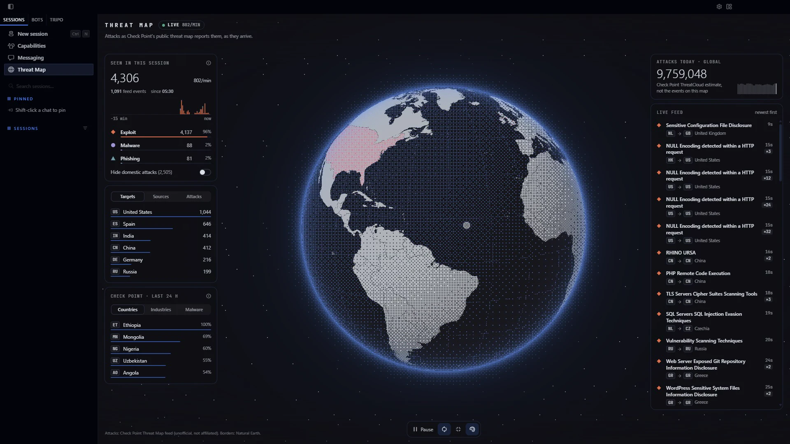
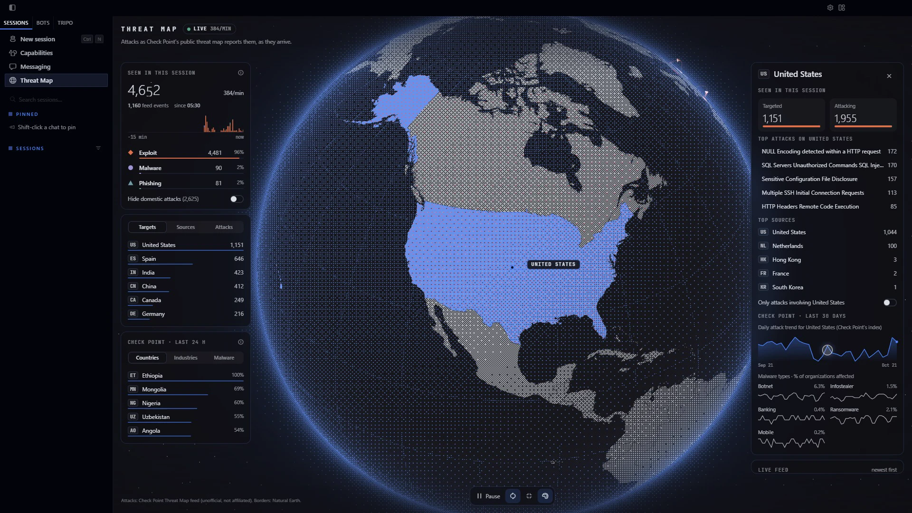
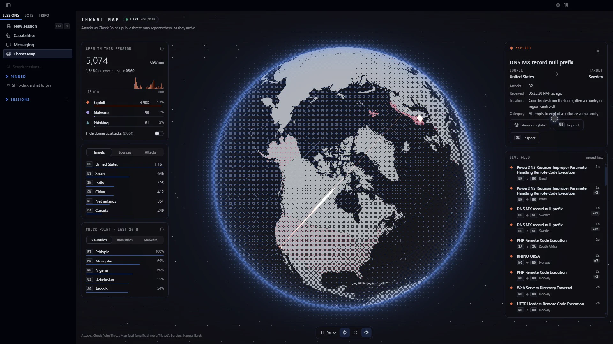

# Hermes Threat Map

A live cyber threat map page for Hermes Desktop. Attacks reported by Check Point's public threat
map stream onto a dithered 3D globe as glowing arcs, with a live feed, filters, country drill-downs
and session statistics.



Unofficial community plugin; not affiliated with or endorsed by Check Point Software Technologies.
**For personal, non-commercial use only** (see [Data source](#data-source)).

## What you get

- **A globe you can explore.** Drag to spin (with inertia), scroll or pinch to zoom, double-click to
  dive in. It spins slowly when idle. Countries light up with heat as attacks land.
- **Attack arcs that read without colour.** Each category has its own colour (from your Hermes
  theme), arc pattern and impact shape:

  | Category | Arc | Impact |
  |---|---|---|
  | Exploit | solid | ◆ diamond |
  | Malware | dashed | ● circle |
  | Phishing | dotted | ▲ triangle |

- **Live feed.** Newest attacks first. Hover a row to highlight its arc; click it for details and a
  camera move that frames the attack. Identical reports that arrive in a burst fold into one row (×N).
- **Country inspection.** Click a country on the globe or in a ranking: what this session saw
  targeting it and coming from it, its top attacks and sources, and Check Point's own 30-day trend
  and malware-family breakdown. "Only attacks involving …" isolates it on the globe and in the feed.
- **Honest numbers.** "Seen in this session" counts what the feed delivered while you watched.
  "Attacks today · global" is Check Point's own estimate and is labelled as such; the two are never
  mixed.
- **Filters and controls.** Toggle categories (keys 1–3), hide domestic attacks, pause and resume
  (Space), reset the view (R), auto-rotate (A), dithered or smooth globe (D), arrows to rotate, +/- to
  zoom, Esc to close a panel.
- **Demo mode.** Simulated traffic for trying the page without the live feed. It is labelled on every
  surface (status pill, a striped banner on the globe, a badge on every row) and never mixed with live
  data: switching sources starts a fresh session.

| Country inspection | Attack details |
|---|---|
|  |  |

It follows your Hermes theme (dark and light, every colour comes from theme variables), respects
reduced motion (arcs draw in place, no camera flights or spin), works in split tiles and narrow
panes, and stops all network, timers and GPU work when you leave the page or the window is hidden.

## Install

Requires Hermes Agent 0.22.2 or newer with Hermes Desktop.

1. Put this folder in your Hermes plugins directory, e.g. clone it:

   ```bash
   git clone https://github.com/Adolanium/hermes-threatmap ~/.hermes/plugins/hermes-threatmap
   ```

   (Windows: `%LOCALAPPDATA%\hermes\plugins\hermes-threatmap`.) Or use **Capabilities → Plugins →
   Install from Git** in Hermes Desktop.
2. Enable the Python half, which relays the live feed. In `config.yaml`:

   ```yaml
   plugins:
     enabled:
       - hermes-threatmap
   ```

   then restart the gateway (or Hermes).
3. In **Capabilities → Plugins**, open Threat Map and turn on **Desktop**.
4. Open **Threat Map** from the sidebar, the ⌘K/Ctrl+K palette ("Open Threat Map"), or the status-bar
   chip. The first visit asks whether to connect the live feed or explore demo data.

Without step 2 the page still works in demo mode and tells you the live feed needs its backend.

## Data source

Live data comes from the Server-Sent Events stream behind
[threatmap.checkpoint.com](https://threatmap.checkpoint.com). Before you connect, know that:

- **It isn't an official API.** Check Point does not document or license it; it can change or stop
  at any time.
- **Check Point's [website terms](https://www.checkpoint.com/privacy/terms/) restrict automated
  access** and reuse of site materials. The page asks for your consent first and is meant for
  personal, informational viewing. Get Check Point's permission before redistributing the data or
  using it commercially.
- **It connects through your own gateway, only while the page is open.** One upstream connection
  is shared by every open window, closed 45 s after the last poll. Nothing is stored on disk or sent
  anywhere else; requests identify themselves as `hermes-threatmap`.

Full findings (endpoints, event schema, rates, limits and alternatives) are in
[docs/data-source.md](docs/data-source.md).

## How it works

```
Check Point SSE ──► dashboard/plugin_api.py ──(poll /events?after=seq, 1 s)──► desktop/plugin.js
   (one stream)      threatmap/feed.py: parse,                                 three.js globe +
                     validate, mark repeats,                                   React overlay
                     bounded buffer, reconnect
```

- **Backend** (`threatmap/`): an incremental SSE parser, strict validation (bad events are counted
  and dropped; missing coordinates fall back to the country), a 2,000-event ring buffer with a
  cursor, reconnect with exponential backoff and jitter, stall detection (45 s without bytes or
  keep-alives), a per-second rate cap, and an "unavailable" state after repeated 401/403/404/410s.
  The browser can't call the feed itself: it is CORS-locked to Check Point's own origin.
- **Desktop** (`desktop-src/`, bundled to `desktop/plugin.js`): the globe is one three.js scene
  with four draw calls. Country borders are a baked 4096×2048 Natural Earth index raster sampled in
  the shader, so hover, selection and heat cost a texture lookup. Arcs and impacts are GPU-instanced
  pools animated entirely in shaders; the CPU writes a few floats per attack. Incoming batches are
  spread over the poll interval, and under a burst the arcs are sampled while the feed and
  statistics still get every event. All session state has fixed caps.

Measured in Hermes Desktop (RTX 3090, 1920×1080): a steady 60 fps on the live feed, and 59 fps with
no long tasks while ingesting 300 events per second for 10 seconds.

## Development

```bash
cd desktop-src
npm ci
npm run build    # writes ../desktop/plugin.js
npm test         # page-side data handling (node --test)
npm run geo      # re-bake src/geo/world.generated.js from world-atlas
```

Python tests (feed parsing, validation, buffering, reconnects, lookups):

```bash
python -m pip install pytest httpx fastapi
python -m pytest
```

To develop against a running Hermes, link the checkout into your plugins directory (a symlink, or a
directory junction on Windows). Desktop then hot-reloads `desktop/plugin.js` on every build.
Backend changes need a gateway restart.

## Credits

- Attack data: [Check Point Threat Map](https://threatmap.checkpoint.com) (unofficial use, see above).
- Borders: [Natural Earth](https://www.naturalearthdata.com) via
  [world-atlas](https://github.com/topojson/world-atlas), public domain.
- Rendering: [three.js](https://threejs.org) (MIT). Visual direction inspired by dithercn's dithered
  globe and Cobe.

MIT licensed. See [LICENSE](LICENSE).
